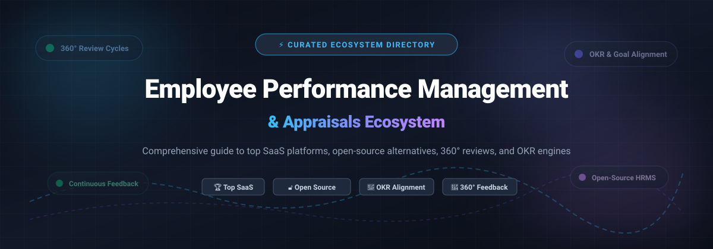

# 🚀 Awesome Employee Performance Management & Appraisals

### 🌟 A Curated Directory of SaaS Platforms, Open-Source HRMS, OKR Systems & 360° Review Tools

  
  
  
  
  

  <b>Keywords:</b> Employee Performance Management, Performance Appraisals, 360 Degree Feedback, Continuous Feedback, OKR Tracking, Open-Source HRMS, Talent Management, Engineering Career Ladders, Review Cycles

---

## 📖 Overview

Welcome to the definitive, SEO-optimized awesome list tracking notable **SaaS platforms** and **open-source software** for **Employee Performance Management, Appraisals, and Continuous Feedback**.

Whether you are an HR leader designing quarterly appraisal cycles, an engineering manager setting up 360° reviews and career frameworks, or a CTO looking for self-hosted, privacy-first open-source HRMS solutions to prevent exponential per-seat costs, this curated guide offers factual insights, pricing benchmarks, and architecture breakdowns.

---

## 📑 Table of Contents
- [📊 Sector Overview & Market Dynamics](#-sector-overview--market-dynamics)
- [☁️ SaaS & Hosted Platforms](#️-saas--hosted-platforms)
- [💻 Open-Source GitHub Projects](#-open-source-github-projects)
- [🛠️ Engineering Review Drafting & Developer Tools](#️-engineering-review-drafting--developer-tools)
- [🤝 How to Contribute](#-how-to-contribute)
- [💖 Support & Community](#-support--community)
- [⭐ Star History](#-star-history)
- [⚠️ Disclaimer](#️-disclaimer)

---

## 📊 Sector Overview & Market Dynamics

The global employee performance management software market is valued at approximately **$3.5B to $4.5B** and is projected to expand beyond **$8B by 2030** (growing at an estimated 10%–12% CAGR).

The sector is **moderately fragmented**:
* **Enterprise Heavyweights:** Large cloud HCM platforms (Workday, SAP SuccessFactors, Oracle Cloud HCM) capture substantial enterprise spend through bundled workforce suites.
* **Specialized Point & Modern Suites:** Best-of-breed platforms like Lattice, Culture Amp, and 15Five lead the mid-market with dedicated OKR goal alignment, continuous praise, 1:1 check-ins, and employee sentiment analytics.
* **Open-Source & Self-Hosted Alternatives:** Increasingly favored by data-sovereign enterprises and engineering organizations seeking to eliminate escalating per-employee subscription fees while maintaining customized review workflows.

---

## ☁️ SaaS & Hosted Platforms

A breakdown of top commercial performance management platforms, complete with verified starting prices, trial availability, and estimated company scales (sorted in descending order of valuation/revenue):

| Product | 🏢 Company Size (Valuation / Est. Revenue) | 💵 Pricing (Starting) | ⏱️ Free Tier / Trial Limits | 📝 Description |
|---|---|---|---|---|
| **[Lattice](https://lattice.com/)** | **$3.0B valuation** (~$130M+ ARR) | **$10/seat/month** (Performance module; min. $4,000/yr annual agreement) | No permanent free tier; live demo and customized pilot via sales | Leading performance management platform connecting reviews, real-time goals, 1:1s, and engagement analytics. Implementation support included. |
| **[Culture Amp](https://www.cultureamp.com/)** | **$1.5B valuation** (~$100M–$175M ARR) | **~$5–$14/employee/month** (Min. annual spend ~$4,500/yr) | No permanent free tier; product walkthrough via sales consultation | Enterprise employee experience platform with research-backed survey instruments, peer benchmarks, and continuous performance reviews tailored for 200+ seat organizations. |
| **[Leapsome](https://www.leapsome.com/)** | **$800M valuation** (~$35M ARR) | **€7/employee/month** (~$7.50/seat/mo; billed annually) | **14-day free trial** (Full sandbox access; requires sales enablement) | All-in-one people enablement platform unifying performance reviews, 360° feedback, competency frameworks, and OKRs. |
| **[15Five](https://www.15five.com/)** | **$250M–$500M valuation** (~$100M ARR) | **$11/user/month** (Perform tier, billed annually) | **14-day free trial** (Access to core features without permanent free plan) | Human-centered performance platform featuring weekly check-ins, 360 review cycles, OKRs, and AI-assisted appraisal drafting. |
| **[Betterworks](https://www.betterworks.com/)** | **$177M valuation** (~$40M ARR) | **$8/user/month** (Performance tier, billed annually) | No permanent free tier; sandbox evaluation via sales demo | Enterprise performance management software centered on transparent OKR goal alignment, regular manager conversations, and talent calibration reviews. |
| **[PerformYard](https://www.performyard.com/)** | **~$95M funding** (~$57M ARR) | **$5/person/month** ($5–$15/person/month based on modules; billed annually) | No permanent free tier; customized live guided demo via sales | Flexible performance review software offering customizable appraisal forms, continuous feedback, goal tracking, and dedicated customer success. |
| **[Small Improvements](https://www.small-improvements.com/)** | **Bootstrapped** (~$5.6M ARR) | **$3/user/month** (Launch plan, billed annually; min. 20 users) | **30-day free trial** (Full access to reviews & feedback features; min. 20 users for paid plans) | Transparent, lightweight review tool featuring 360-degree feedback, praise walls, 1:1 agendas, and pulse surveys built for small and growing teams. |

---

## 💻 Open-Source GitHub Projects

Self-hosted, transparent, and extensible alternatives for organizations wanting direct control over sensitive employee appraisal data and immunity from per-user license compounding. Repositories are sorted in descending order of GitHub_Stars:

| Project | ⭐ GitHub_Stars | 🛠️ Tech Stack & Focus | 📋 Key Features & Appraisal Capabilities |
|---|---|---|---|
| **[Frappe HR](https://github.com/frappe/hrms)** |  | Python, Frappe, Vue.js | **The most feature-complete open-source HRMS with native performance appraisals.** Includes goal setting aligned with Key Result Areas (KRAs), customizable multi-stage appraisal cycles, manager/self ratings, and direct payroll integration. |
| **[Ever Gauzy](https://github.com/ever-co/ever-gauzy)** |  | TypeScript, NestJS, Angular/React | **Open enterprise platform with integrated workforce productivity and HRM.** Features employee performance tracking, KPI achievement metrics, daily timesheets, activity analysis, and recognition awards. |
| **[Wukong HRM](https://github.com/WuKongOpenSource/Wukong_HRM)** |  | Java, Spring Boot, Vue.js | **One-stop open-source human resource management suite.** Provides a dedicated performance appraisal module supporting custom evaluation forms, KPI weighting, approval workflows, and grading distribution. |
| **[Horilla HRMS](https://github.com/horilla/horilla-hr)** |  | Python, Django | **Modern, modular open-source HRMS.** Includes built-in performance tracking, objective goal setting, feedback cycles, onboarding, and attendance with role-based dashboard permissions. |
| **[OrangeHRM](https://github.com/orangehrm/orangehrm)** |  | PHP, Symfony, MySQL | **One of the longest-standing open-source HRM engines.** Features key performance indicators (KPIs), performance trackers, 360-degree reviews, self-appraisals, and comprehensive competency evaluations. |
| **[Operately](https://github.com/operately/operately)** |  | Elixir, Phoenix, React | **The open-source company operating system.** Focuses on company-wide transparency, OKR management, milestone goal check-ins, and continuous progress updates across teams. |
| **[Thrive Goals](https://github.com/get-thriving/thrive)** |  | TypeScript, Node.js | **Dedicated goals and OKRs tracking system.** Enables teams to set quarterly milestones, align individual targets with organizational pillars, and monitor status check-ins. |
| **[Thinksy](https://github.com/Thinksy-app/thinksy)** |  | TypeScript, Slack API | **Self-hosted Slack app for performance reviews.** Summarizes achievements, wins, and contributions directly from daily team conversations to streamline review prep. |
| **[Blik](https://github.com/thijsdezoete/blik)** |  | TypeScript, Next.js | **Self-hosted and open-source anonymous 360° review tool.** Provides frictionless peer-review workflows where colleagues can submit candid, constructive feedback securely. |
| **[PPSP 360 Evaluation](https://github.com/dolphinotaku/PPSP-360_Degree_Evaluation_System)** |  | PHP, Web | **Web-based e-appraisal platform.** Facilitates 360-degree feedback processes to assess team collaboration, manager feedback, and individual contributor performance. |
| **[Work Chronicler](https://github.com/tkstang/work-chronicler)** |  | TypeScript, CLI / MCP | **CLI tool and Model Context Protocol (MCP) server.** Pulls merged GitHub PRs and Jira tickets into a searchable markdown log for appraisal self-evaluations and brag documents. |
| **[MeepleOS](https://github.com/JustGoscha/meepleOS)** |  | Vanilla JavaScript | **Lightweight review tool for engineering leaders.** MIT-licensed with zero configuration. Features role-specific and level-guided rubrics for Software Engineers, PMs, and Product Designers. |

---

## 🛠️ Engineering Review Drafting & Developer Tools

Specialized developer-first utilities to automate appraisal drafting from source code repositories and contribution histories:

* **[QuarterMaster](https://socket.dev/npm/package/%40imponenm%2Fquartermaster)**: Automates performance review drafting directly from GitHub PRs, commits, and code review activity using LLMs (Anthropic, OpenAI, or local Ollama) mapped against predetermined milestone goals.

---

## 🤝 How to Contribute

Contributions are warmly welcomed! Help expand and maintain this performance management directory:

1. **Fork the repository** to your own GitHub account.
2. **Add or edit entries** in `README.md` following the established table structure.
3. Ensure every entry includes:
   - Official product / repository link
   - Realistic pricing or verified GitHub Stars_Badge
   - Objective, factual description
4. Submit a **Pull Request** with a concise summary of your addition.

---

## 💖 Support & Community

If you find this repository helpful for evaluating HR tools, planning appraisal systems, or saving money on per-seat SaaS costs, please consider supporting the project:

- ⭐ **Star this repository** to help others discover it.
- 🍴 **Fork it** to maintain your own internal benchmark.
- 📢 **Share it** on LinkedIn, X/Twitter, or your favorite HR tech community.
- ☕ **Buy a Coffee / Sponsor**: Support ongoing maintenance directly on the [GitHub Sponsor Dashboard](https://github.com/sponsors/ishandutta2007). Thank you for your support!

---

## ⭐ Star History

---

## ⚠️ Disclaimer

- This is an independent, **community-curated guide** intended for informational purposes and does not constitute an endorsement.
- **Data Protection & Privacy**: Performance reviews and appraisal records contain sensitive personal data and manager evaluations. Always implement stringent role-based access control (RBAC), end-to-end encryption, and regulatory compliance (GDPR, SOC 2, HIPAA where applicable).
- **Pricing & Total Cost of Ownership**: SaaS vendors frequently revise packaging tiers and enforce minimum spend thresholds (e.g., Lattice's $4,000 baseline or Culture Amp's enterprise tiers). Always verify current license agreements and implementation charges before signing.

---

  <b>Built with ❤️ for People Operations leaders, HR tech architects, and engineering managers worldwide.</b>

